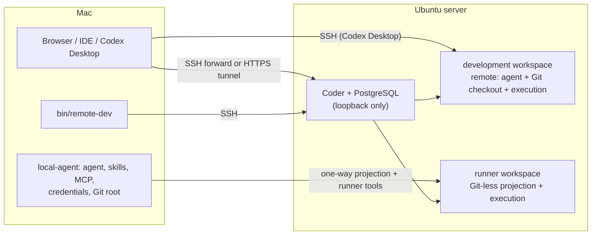

# Remote development toolkit

**Remote development toolkit by Anonima Studio.** Author: Yury Telitsin.

A scripts-first toolkit that turns one Ubuntu server into a remote development
host for AI coding agents and their workloads. [Coder](https://coder.com)
Community owns workspaces; this repository owns the reproducible host
deployment, a constrained Docker workspace template, operator checks, and a
recovery contract. The command-line entry point is `remote-dev`, run from a Mac.

Russian: [docs/ru/README.md](docs/ru/README.md).

## Why

AI coding agents are good at editing code and poor at owning infrastructure.
Running their builds, tests, dependency installs and Docker stacks on a laptop
competes with everything else on it; moving everything to a server takes the
agent away from the skills, MCP servers, credentials and approvals its operator
configured locally. Most remote setups also blur three questions that this
toolkit keeps separate:

- **Where does the agent run?** On the Mac or inside a workspace, chosen per
  project.
- **Which copy of the source is authoritative?** Exactly one per working copy,
  never two writable copies kept in sync.
- **What counts as done?** A result the user can open on their own machine, not
  a `localhost` URL inside a remote container.

The methodology behind these answers is called **local agents, remote
execution**. It is described, rule by rule, with the file or test that enforces
each rule, in [docs/methodology.md](docs/methodology.md).

## Two entry paths

| If you want to… | Start here |
| --- | --- |
| **See how it is engineered** — principles, decisions, architecture, threat model, how it is verified | [Methodology](docs/methodology.md) → [Architecture](docs/architecture.md) → [Limitations](docs/limitations.md) → [Status](#status) |
| **Run it** — requirements, one command, first workspace, recovery | [Quickstart](docs/quickstart.md) → [Development modes](#development-modes) → [Limitations](docs/limitations.md) |

## Status

Released as portfolio and product, as is. Maturity levels:

- **stable** — interface settled, covered by the automated test suite, used by
  the maintainer for daily work;
- **beta** — implemented and covered by automated tests; the interface or
  operating procedure may still change;
- **prototype** — the mechanism is provided, but its end-to-end procedure is not
  rehearsed as part of this release.

| Component | Maturity | How it is verified |
| --- | --- | --- |
| Host bootstrap (`bootstrap/ubuntu.sh`) | stable | Shell lint in CI; runs as the first step of the quickstart on a fresh server |
| Coder deployment, `install`, `doctor`, `status`, `audit` | stable | CLI smoke test with synthetic profiles in CI; `doctor` on your host after quickstart |
| One-command start (`quickstart`, `init`) and minimal topology (`ssh-forward` + `host`) | beta | Profile topology and CLI smoke tests in CI (`init`, validation, SSH forward); the server part is verified by running the quickstart, which ends with `doctor` |
| Advanced topology (Cloudflare Tunnel + WireGuard egress) | beta | Network contract smoke test in CI; `doctor` checks tunnel, handshake, policy route and fail-closed route on your host |
| Docker workspace template (`core`/`containers`, roles, sizes, PID caps) | stable | Linux image build, source hash, workspace, role and image-retention tests in CI; `doctor` image checks |
| `remote` mode with Codex Desktop / Codex CLI adapter (optional) | stable | Codex and Codex Desktop smoke tests in CI |
| `preview`, `debug-forward`, `project-setup`, `worktree-vars` | stable | Preview, project-setup and worktree-vars smoke tests in CI |
| Secret transfer manifests (`secrets plan/apply/verify`) | beta | Secret upload, read and binding tests in CI (synthetic payloads) |
| `local-agent` mode (runner binding, MCP tools, working sets, re-anchor) | beta | Local Agent lifecycle, MCP, working-set, re-anchor and recovery-gate tests in CI with fake Coder and Mutagen |
| Mode switching (`mode plan/apply/resume/abort/rebind/forget`) | beta | Mode, endpoint, operation, transport and rebind tests in CI with real Git and simulated transport |
| Automated workspace preparation inside mode switching (`--prepare-workspace`) | prototype | Workspace-plan tests in CI; not rehearsed against a live deployment for this release |
| Owner credential handoff (`credentials`) | beta | Credentials smoke test in CI |
| Scoped Codex updates (`codex-update`, `workspace update`, `pids-rollout`) | beta | Codex update and PID release tests in CI |
| Off-host backup (`backup/`) | prototype | Shell lint only; restore has not been rehearsed as part of this release |

CI runs `pnpm lint` and `pnpm test` on macOS (the client platform) for every
push and pull request, plus a Linux workspace image build, Coder Compose
validation with a sample environment and a secret scan. See
[.github/workflows/ci.yml](.github/workflows/ci.yml).

## Quickstart

You need a Mac with the Coder CLI, Git, Python 3 and an SSH client, and a fresh
Ubuntu 24.04 or 26.04 server that accepts your SSH key for `root`. Full
requirements and per-step recovery: [docs/quickstart.md](docs/quickstart.md).

```bash
git clone https://github.com/anonima-studio/remote-development-toolkit.git remote-dev && cd remote-dev
bin/remote-dev quickstart example-profile --ssh root@<server-ip>
```

The command bootstraps and hardens the server, writes a host profile with the
minimal topology, installs Coder and runs `doctor`. Expect 15–30 minutes on a
first run; most of it is the system upgrade and the workspace image build. Add
`--admin-key <path>` when the server accepts a different key than your default.
Then:

```bash
bin/remote-dev --profile example-profile forward          # keep running
bin/remote-dev --profile example-profile credentials reveal coder \
  --confirm-profile example-profile                       # in a second terminal
```

Open <http://127.0.0.1:3080>, sign in as the owner, and create a workspace from
the **Remote Dev Docker** template.

## Development modes

| Mode | Agent and its skills, MCP, credentials | Authoritative Git checkout | Dependencies, build, test, run, debug, Docker |
| --- | --- | --- | --- |
| `remote` | Coder development workspace | Same workspace | Same workspace |
| `local-agent` | Mac | Mac (one Git root or an explicit working set) | Dedicated Coder runner workspace |



- `remote`: open the workspace from Codex Desktop over SSH; everything runs in
  Linux. See [Codex on Coder](docs/codex-on-coder.md).
- `local-agent`: the agent stays on the Mac and calls seven context-bound runner
  tools; the runner receives a verified one-way projection of the local source.
  See [Local Agent mode](docs/local-agent-mode.md).
- Switching a project between modes is an explicit, journaled operation:
  [Mode switching](docs/mode-switching.md).

Each workspace has one immutable role (`development` or `runner`); the two
modes never share a workspace. Codex integration is an optional adapter; the
modes, previews, secrets and checks do not depend on it.

## Repository map

| Path | Owns |
| --- | --- |
| [`bin/remote-dev`](bin/remote-dev) | Mac-side operator entry point and subcommands |
| [`bootstrap/`](bootstrap/README.md) | Ubuntu host baseline: `dev` user, SSH hardening, UFW, Docker, restic |
| [`deploy/host-profiles/`](deploy/host-profiles/README.md) | Non-secret deployment identity per server; loader and validation |
| [`deploy/coder/`](deploy/coder/README.md) | Digest-pinned Coder and PostgreSQL Compose deployment |
| [`deploy/cloudflared/`](deploy/cloudflared/README.md) | Optional Cloudflare Tunnel ingress |
| [`deploy/wireguard/`](deploy/wireguard/README.md) | Workspace networks and optional WireGuard egress |
| [`deploy/sysbox/`](deploy/sysbox/install.sh) | Checksum-pinned Sysbox for nested Docker in `containers` workspaces |
| [`templates/docker/`](templates/docker/README.md) | Coder workspace template, workspace image and in-workspace helpers |
| [`backup/`](backup/README.md) | restic backup producer and restore runbook |
| [`.agents/skills/remote-development/`](.agents/skills/remote-development/SKILL.md) | Agent skill for adopting projects into this setup |
| [`templates/docker/skills/worktree-branch-sync/`](templates/docker/skills/worktree-branch-sync/SKILL.md) | Agent skill installed into workspaces |
| [`tests/`](tests) | Offline test suite (fake Coder, Mutagen and SSH transports) |
| [`docs/`](docs) | Methodology, architecture, guides and limitations |

## Documentation

- [Methodology: local agents, remote execution](docs/methodology.md)
- [Architecture and threat model](docs/architecture.md)
- [Quickstart](docs/quickstart.md) and [advanced topology](docs/advanced-topology.md)
- [Codex on Coder](docs/codex-on-coder.md), [Codex worktrees](docs/codex-worktrees.md)
- [Local Agent mode](docs/local-agent-mode.md), [mode switching](docs/mode-switching.md)
- [Universal project setup](docs/project-setup.md), [workspace updates](docs/workspace-updates.md)
- [Limitations](docs/limitations.md)
- [Third-party components](THIRD_PARTY.md), [security policy](SECURITY.md), [support](SUPPORT.md)

## License and attribution

Remote development toolkit by Anonima Studio. Copyright 2026 Yury Telitsin.
The project's own code and documentation are licensed under the
[Apache License 2.0](LICENSE); see [NOTICE](NOTICE). Components the toolkit
installs or pins keep their own licenses; see [THIRD_PARTY.md](THIRD_PARTY.md).

## Support policy

Provided as is, without an SLA. Issues are welcome; pull requests are reviewed
at the maintainer's discretion. See [SUPPORT.md](SUPPORT.md) and report
vulnerabilities privately as described in [SECURITY.md](SECURITY.md).

Routine dependency updates are scheduled monthly; security fixes are handled
immediately. Immutable image digests, explicit package pins and the lockfile
make updates deliberate and reviewable. Current versions are defined in
[`templates/docker/Dockerfile`](templates/docker/Dockerfile) and
[`deploy/coder/compose.yaml`](deploy/coder/compose.yaml). Pick an explicit Codex
version per workspace with `codex-update --version <version>`; see the complete
[update policy and commands](SUPPORT.md#dependency-updates).
