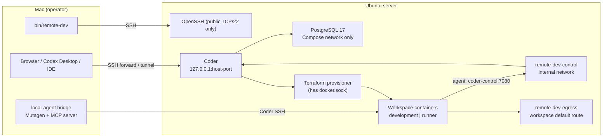
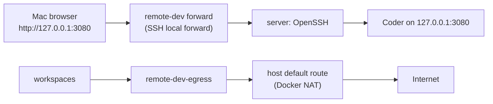
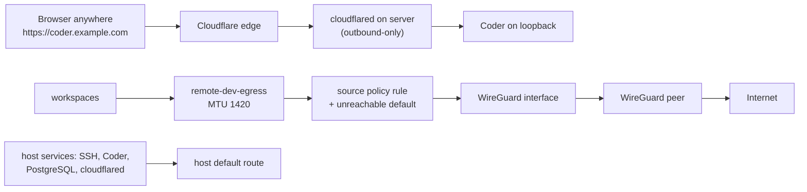

# Architecture

This document describes the components, their ownership boundaries, both
network topologies, the data and secret flows, and the threat model. The
reasoning behind the boundaries is in [methodology.md](methodology.md).

## Decision

The toolkit does not build its own control plane. Coder Community already
provides templates, workspace lifecycle, agent connectivity, SSH and a web
dashboard. The toolkit is a reproducible, opinionated packaging of Coder for a
single trusted operator:

- an Ubuntu host baseline and security hardening;
- a digest-pinned Coder and PostgreSQL deployment;
- a constrained Docker workspace template with fixed roles and resource sizes;
- operator checks: `doctor`, `status`, `audit`;
- Mac-side adapters: previews, debug forwards, project setup, secrets, Local
  Agent, mode switching and an optional Codex adapter;
- a backup producer and a restore runbook.

The Mac is a thin client in `remote` mode and the agent host in `local-agent`
mode. In both modes, project workloads run on the server.

## Components and ownership

### Coder owns

- users and session tokens;
- template versions and Terraform state;
- workspace create, start, stop, update, delete and autostop deadlines;
- agent connectivity, SSH, web terminal and live metadata;
- the dashboard and API for all of the above.

### The toolkit owns

- the host baseline: `dev` user, SSH hardening, UFW, Docker, restic
  ([`bootstrap/ubuntu.sh`](../bootstrap/ubuntu.sh));
- the Coder/PostgreSQL deployment and its version pins
  ([`deploy/coder/`](../deploy/coder/README.md));
- the deployment identity in host profiles
  ([`deploy/host-profiles/`](../deploy/host-profiles/README.md));
- workspace networks and optional ingress/egress components
  ([`deploy/wireguard/`](../deploy/wireguard/README.md),
  [`deploy/cloudflared/`](../deploy/cloudflared/README.md));
- the workspace template and image: roles, capabilities, sizes, PID caps,
  labels, image retention ([`templates/docker/`](../templates/docker/README.md));
- the operator contract: `install`, `doctor`, `status`, `audit` and the
  recovery path printed by each command;
- the Mac-side transport for previews, debug ports, secrets, Local Agent and
  mode switching;
- the backup producer and the clean-host restore runbook
  ([`backup/`](../backup/README.md)).

### Each project owns

- repository, branch and worktree policy, and Git transport authorization;
- runtime and package-manager pins;
- setup, start, build, test and health commands, declared in
  `.remote-dev/project.env` when it uses [`project-setup`](project-setup.md);
- Compose topology, preview ports and service containers;
- secret acquisition and rotation (the toolkit only transfers approved files);
- application-consistent dump and restore of mutable data.

## Execution path



1. `bootstrap/ubuntu.sh` brings a fresh Ubuntu 24.04 or 26.04 host to the
   baseline. `quickstart` runs it through an administrative SSH login.
2. A host profile binds the SSH alias, Coder access URL and loopback port, the
   two workspace networks and, for the advanced topology, the tunnel and
   WireGuard identity. An incomplete profile stops before any remote change.
3. `install` uploads the deployment, creates missing server-side secrets, starts
   digest-pinned Coder and PostgreSQL, creates the first owner and an operator
   session, imports the template when its content changed, and reconciles an
   eight-hour default autostop with a one-hour activity bump.
4. Coder runs Terraform for workspace lifecycle. Terraform creates the
   workspace container and its persistent home volume (plus a Docker data
   volume for `containers` workspaces).
5. The Coder agent inside each workspace connects to Coder over the internal
   `remote-dev-control` network using `http://coder-control:7080`, so agent
   traffic never leaves the host.
6. Agents (Codex or others) are workload inside a workspace, or Mac-side
   clients that reach a runner only through bounded tools.

## Topologies

A profile chooses ingress (`REMOTE_DEV_PROFILE_INGRESS`) and egress
(`REMOTE_DEV_PROFILE_EGRESS`) independently. In both topologies the only
public inbound service is OpenSSH, and Coder binds to server loopback.

### Minimal: `ssh-forward` + `host` (default for new profiles)



- Nothing is published. The browser and the Mac Coder CLI reach Coder through
  `remote-dev --profile <name> forward`, which forwards
  `127.0.0.1:<local-port>` on the Mac to Coder's loopback port on the server.
  The Coder access URL is `http://127.0.0.1:3080` by default.
- Workspaces leave through the host's own Internet route with Docker's standard
  NAT. Only the two managed Docker networks are created.
- Needs no third-party account or credential.

### Advanced: `cloudflare-tunnel` + `wireguard`



- A named Cloudflare Tunnel publishes Coder at a public HTTPS hostname through
  outbound-only connections; ports 80 and 443 stay closed on the server.
- Workspace egress is routed through a WireGuard peer by a source policy rule.
  A lower-priority `unreachable default` route in the same table makes a lost
  tunnel fail closed instead of falling back to the host route. A dedicated
  chain under Docker's `DOCKER-USER` allows the egress subnet to forward only
  through the WireGuard interface. Host-originated traffic keeps the host route.
- The egress network and nested Docker bridges use MTU 1420 to match
  WireGuard, so large responses do not stall inside nested containers.
- Needs a Cloudflare tunnel credential and a WireGuard client configuration.
  Setup: [advanced-topology.md](advanced-topology.md).

The two axes are independent: `ssh-forward` + `wireguard` and
`cloudflare-tunnel` + `host` are valid profiles.

## Workspaces

One Coder workspace is one isolation identity with exactly one role for its
lifetime:

| Role | Mode | Contents |
| --- | --- | --- |
| `development` | `remote` | Authoritative Git checkout, agent, IDE backend, dependencies, services |
| `runner` | `local-agent` | Git-less projection of Mac source, dependencies, services; no IDE apps |

| Capability | Docker inside the workspace |
| --- | --- |
| `core` | Docker CLI only, no daemon |
| `containers` | Internal Docker daemon under the `sysbox-runc` runtime; Docker data on its own volume |

| Size | CPU | RAM | Soft storage budget |
| --- | ---: | ---: | ---: |
| `small` | 1 | 2 GiB | 20 GiB |
| `standard` | 2 | 4 GiB | 30 GiB |
| `large` | 3 | 6 GiB | 40 GiB |
| `jetbrains` | 4 | 8 GiB | 50 GiB |
| `jetbrains-xl` | 4 | 12 GiB | 60 GiB |

CPU, RAM and the cgroup PID cap (1024 for `core`, 2048 for `containers`) are
hard limits; the Coder agent starts only after the provisioner has set and
verified the PID cap. Storage is a soft budget that `audit` measures; it is not
quota-backed. Stopping a workspace removes its container and keeps its volumes.

The workspace image is built on the host from a published
[Dockerfile](../templates/docker/Dockerfile) with digest-pinned upstream
stages. Its tag is derived from the source hash; `install` refuses a
source/hash mismatch and keeps every image still referenced by an existing
workspace version alive with a never-started retention container, so a stopped
workspace can always start again.

## Data and secret flows

| Flow | Path | Protection |
| --- | --- | --- |
| Operator commands | Mac → SSH → `dev` on server | Key-only SSH; `dev` has passwordless sudo |
| Dashboard | Mac → SSH forward or Cloudflare Tunnel → Coder loopback | No public Coder port |
| Coder owner password | Generated on server → `bootstrap-owner.env` (mode `0600`) → `credentials reveal` → one-time loopback page on Mac | Never in argv, URL, stdout or Git; server copy removed only by `credentials finalize` |
| Operator session | Server file `/opt/remote-dev/coder/operator.session` (mode `0600`) | Never leaves the server; replaced with `token-update` from stdin |
| Tunnel credential, WireGuard config | Mac file (owner-only) → staged over SSH → `/etc/cloudflared`, `/etc/wireguard` (mode `0600`) | Validated against the profile's tunnel ID and public key before upload |
| Project source, `remote` | Git remote → workspace checkout, or one-time bundle import | Git transport authorization checked separately |
| Project source, `local-agent` | Mac Git root → Mutagen one-way → runner projection | Git-less; `.git`, ignored files, secrets and outputs never projected; drift detected by content hash |
| Project secret files | Mac file → stdin → workspace destination (mode `0600`) | Only routes in a reviewed manifest; value-silent verification |
| Runner execution record | Runner → Mac receipt | Stores argument count and program name, never arguments |
| Backup | Server → encrypted restic repository on another host | Append-only credential on the primary |

## Threat model

### Assumptions

- **Single trusted operator.** One person controls the Mac, the server and the
  Coder owner account. Templates and workspaces are trusted. There is no
  multi-tenant isolation.
- The Mac is not compromised. Its SSH key, Coder session and local profile
  files are as trusted as the operator.

### What the design defends against

- Accidental exposure: Coder and PostgreSQL never listen publicly; UFW denies
  inbound traffic except SSH; previews and debug forwards bind to Mac loopback.
- Wrong-target operations: profiles fail closed; secret and credential
  operations require explicit profile, workspace and origin confirmations.
- One workspace exhausting the host: hard CPU, RAM and PID limits per
  workspace; `audit` reports storage growth and missing autostop deadlines.
- Secret leakage through logs, argv, receipts or Git (see the table above).
- Silent source divergence between the Mac and a runner: one-way projection
  with content-hash drift detection.
- In the advanced topology, workspace traffic leaking outside the WireGuard
  path when the tunnel drops: fail-closed route and forward filtering.

### Known privileged components and trade-offs

- **The Coder provisioner has the host Docker socket**, which is
  root-equivalent on the host. This is acceptable only because templates are
  trusted. Workspaces never receive the socket.
- **Nested Docker uses Sysbox.** `containers` workspaces run under
  `sysbox-runc`, which isolates the inner daemon from the host daemon without a
  privileged container. Its guarantees are Sysbox's; it is not a VM boundary.
- **The `dev` user has passwordless sudo.** Anyone holding the operator SSH key
  controls the server. `quickstart` generates `~/.ssh/remote-dev` without a
  passphrase; add one with `ssh-keygen -p -f ~/.ssh/remote-dev`.
- **First contact is trust on first use.** `quickstart` connects with
  `StrictHostKeyChecking=accept-new`: the server's host key is accepted on the
  first connection and enforced afterwards. Verify the fingerprint through your
  provider's console if that matters to you.
- **Runner SSH transport delegates host-key checking to the Coder proxy.**
  Local Agent connects to workspaces through `coder ssh --stdio` as a
  `ProxyCommand` with `StrictHostKeyChecking=no`, the same approach
  `coder config-ssh` uses. The authenticated Coder session identifies the
  workspace; there is no stable per-workspace SSH host key to pin. The proxy
  connection is as protected as the Coder access URL: HTTPS in the advanced
  topology, the SSH forward in the minimal one.
- **Test fault-injection seams exist in production code.** Variables named
  `REMOTE_DEV_LOCAL_AGENT_TEST_*` make the Local Agent bridge pause or fail at
  chosen points so the tests can exercise recovery. Setting them requires
  control of the operator's environment, which already implies full control of
  the bridge. Do not set them outside tests.
- **The first owner password stays on the server** in a mode-`0600` file until
  `credentials finalize` confirms it is stored elsewhere.
- In the minimal topology the Coder access URL is plain HTTP on Mac loopback;
  the transport across the network is the SSH forward.

### Out of scope

- Multiple users or untrusted code: they need a VM or rootless boundary per
  workspace, not another label.
- High availability: one host, one `cloudflared` replica in the advanced
  topology, no standby.
- Hard storage quotas, continuous monitoring and external alerting.
- Provider-level VM creation, DNS and snapshots.
- Coder Enterprise features; only Community features are used.

## Reproducibility

The reproducible unit is this repository plus secrets kept outside Git:

- `bootstrap/ubuntu.sh`: host baseline;
- `deploy/install.sh`: idempotent deployment, owner, session, template and
  schedule; repeating it with unchanged inputs changes nothing;
- [`deploy/coder/compose.yaml`](../deploy/coder/compose.yaml): the single source
  for digest-pinned Coder and PostgreSQL versions, with resource limits;
- [`templates/docker/main.tf`](../templates/docker/main.tf): exact provider
  versions and workspace policy;
- [`templates/docker/Dockerfile`](../templates/docker/Dockerfile): the single
  source for digest-pinned toolchain stages and installed package versions;
- `backup/`: restic script and systemd units.

When the public Terraform registry is unreachable from the server, a profile
may set `REMOTE_DEV_PROFILE_TERRAFORM_MIRROR` and `install` renders a provider
network mirror into the provisioner's Terraform configuration.

## Command surface

```text
remote-dev init | quickstart                       profile and server setup
remote-dev --profile <p> profile | install | doctor | status | audit
remote-dev --profile <p> sysbox-install            nested Docker runtime
remote-dev --profile <p> forward                   dashboard over SSH
remote-dev --profile <p> credentials ...           owner credential handoff
remote-dev --profile <p> token-update              replace the operator session
remote-dev --profile <p> workspace create|start|inspect|update
remote-dev --profile <p> preview | debug-forward   Mac-visible ports
remote-dev --profile <p> project-setup | worktree-vars
remote-dev --profile <p> secrets plan|apply|verify
remote-dev [--profile <p>] local-agent ...         see local-agent-mode.md
remote-dev [--profile <p>] mode ...                see mode-switching.md
remote-dev --profile <p> codex | codex-desktop | codex-update   optional adapter
remote-dev --profile <p> pids-rollout              per-workspace PID policy
```

## Primary sources

- [Coder Docker installation](https://coder.com/docs/install/docker)
- [Coder Docker templates](https://coder.com/docs/admin/templates/extending-templates/docker)
- [Coder `config-ssh`](https://coder.com/docs/reference/cli/config-ssh)
- [Docker resource constraints](https://docs.docker.com/engine/containers/resource_constraints/)
- [Sysbox](https://github.com/nestybox/sysbox)
- [Cloudflare Tunnel](https://developers.cloudflare.com/cloudflare-one/connections/connect-networks/)
- [restic REST server append-only mode](https://restic.readthedocs.io/en/stable/030_preparing_a_new_repo.html#rest-server)
- [Mutagen synchronization](https://mutagen.io/documentation/synchronization/)
